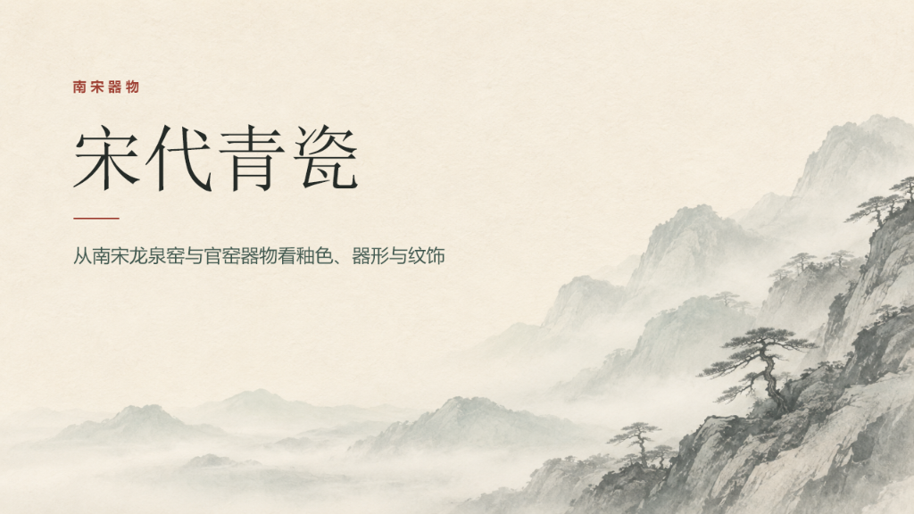

# 宋韵水墨 PPT Skill

面向 Codex 的可复用演示文稿工作流。用淡墨远山、暖纸底和少量朱砂制作中国传统文化主题的 PowerPoint，保留可编辑的标题、正文和图注。

## 使用方法

1. 下载本仓库，把包含 `SKILL.md` 的整个 `song-ink-slides` 文件夹放到项目的 `.agents/skills` 目录，或放到个人的 `$HOME/.agents/skills` 目录。
2. 在 Codex 中选用 `song-ink-slides`，或直接说明要用「宋韵水墨」风格。

> 用宋韵水墨 Skill 做一份 6 页《宋代点茶》课堂展示。配图用来源明确的馆藏照片，交付可编辑 PPTX。

也可以直接打开 [PowerPoint 模板](assets/song-ink-template.pptx)，复制需要的版式并替换文字和照片。

## 文件

- [SKILL.md](SKILL.md) 说明制作与检查流程。
- [视觉与版式](references/visual-system.md) 记录配色、字体与十一种页面规则，含流程图、大图标注和可编辑数据图表。
- [《宋代青瓷》示例](examples/song-dynasty-celadon.pptx) 展示成品效果。器物照片来自大都会艺术博物馆的公有领域馆藏，来源见对应页的演讲者备注。山水是为模板制作的生成背景。
